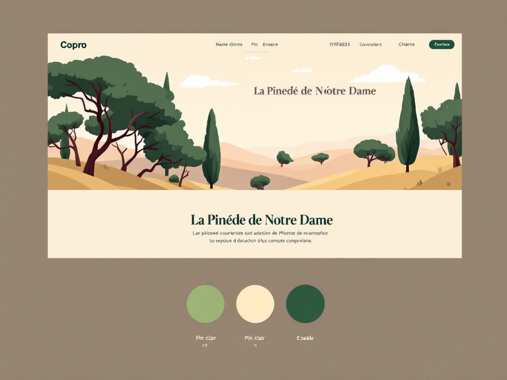
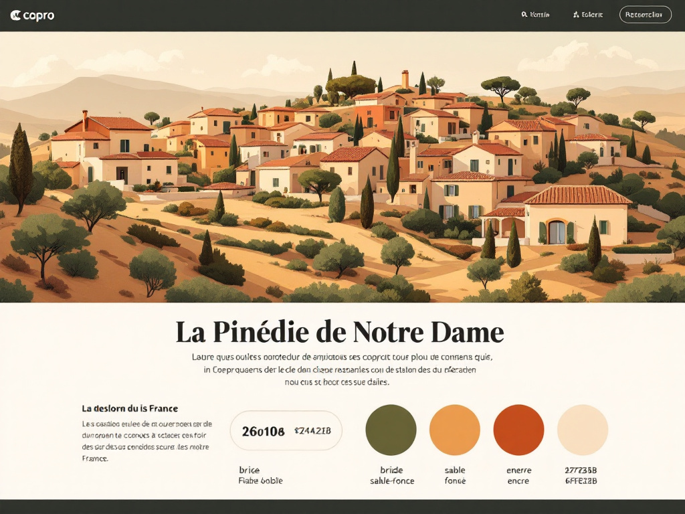
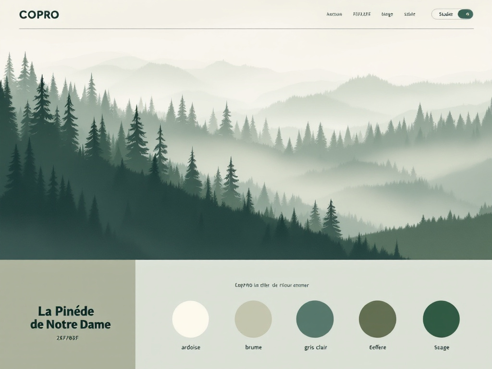

# Moodboards — identité visuelle

Trois directions proposées le 2026-11-17 pour l'identité visuelle de l'application
**Copro La Pinède de Notre Dame** (copropriété de pavillons en copro horizontale, à flanc
de colline, bordant une pinède et une forêt méditerranéenne de chênes bas — Gardanne, 13).

Brief : **moderne et épuré au maximum, mais léché, doux et agréable à l'œil**.

## Voir les moodboards

- Ouvrir [`index.html`](index.html) (ou chaque board) directement sur GitHub ou en local dans un navigateur.
- Chaque board : scène d'ambiance + palette exacte (tokens/hex) + typographie + maquette des
  composants clés (barre, boutons, carte ticket avec mini-flowchart, tags, mosaïque de photos) + principes.

| Board | Direction | Ambiance |
|---|---|---|
| [`01-pinede-claire.html`](01-pinede-claire.html) | A — Pinède claire |  |
| [`02-terre-de-gardanne.html`](02-terre-de-gardanne.html) | B — Terre de Gardanne |  |
| [`03-ardoise-brume.html`](03-ardoise-brume.html) | C — Ardoise & brume |  |

## Notes

- Les scènes `scene-*.jpg` sont des illustrations générées par IA (FLUX) dans la palette de chaque direction.
- Règles communes aux trois directions (skill `design-ergonomie`) : contraste ≥ AA, focus clavier
  visible, cibles ≥ 44 px, états toujours avec leur texte (jamais couleur seule), aucun dégradé,
  sentence case en français, `theme-color`/manifest/icônes mises à jour avec la palette.
- La direction retenue sera consignée dans `spécifications/identite-visuelle.md` (nouveau fichier),
  puis implémentée dans `src/public/style.css`, `src/views/partials/header.ejs`, les icônes PWA
  (`src/public/icon.svg` + PNG) et les `mockups/`.
