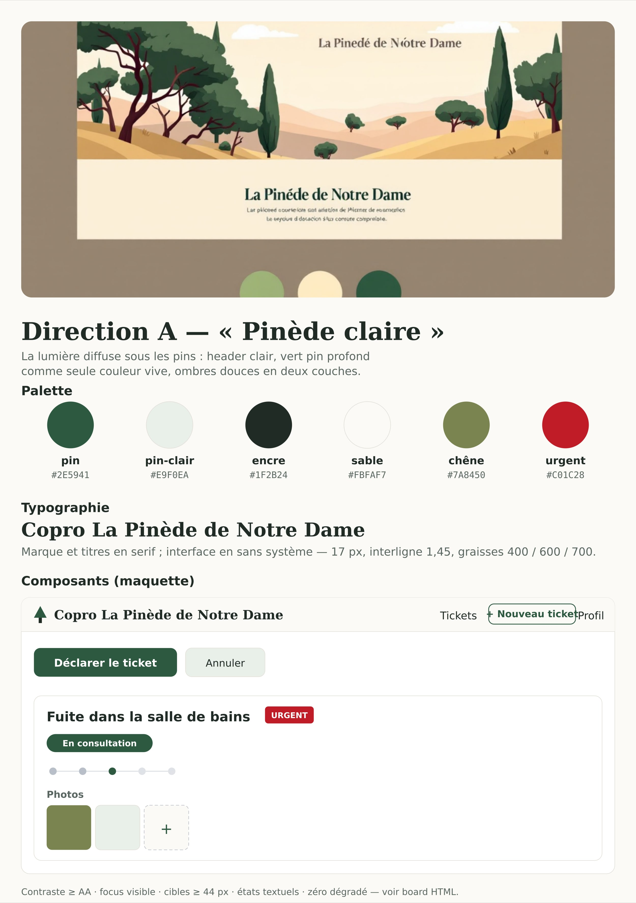
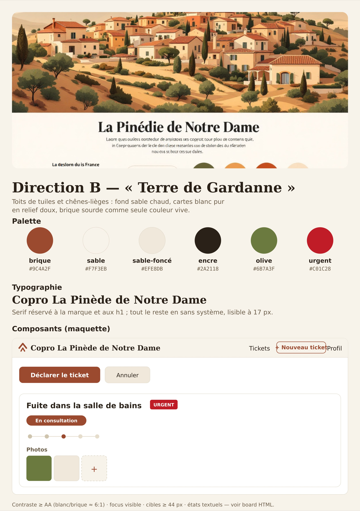
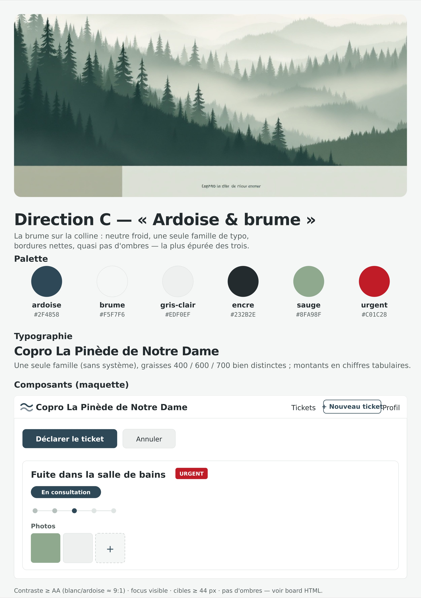

# Moodboards — identité visuelle

Trois directions proposées le 2026-11-17 pour l'identité visuelle de **Copro La Pinède de
Notre Dame** (pavillons en copro horizontale à flanc de colline, bordant une pinède et une
forêt méditerranéenne de chênes bas — Gardanne, 13).

Brief : **moderne et épuré au maximum, mais léché, doux et agréable à l'œil**.

> **Décision (2026-11-17)** : la direction **B — Terre de Gardanne** est retenue et
> implémentée. Voir [`spécifications/identite-visuelle.md`](../../spécifications/identite-visuelle.md).

> **Sur GitHub**, ouvrir ce README : les moodboards ci-dessous sont des images, elles
> s'affichent en ligne. Les boards `0X-*.html` affichent leur code source sur GitHub —
> les ouvrir **en local** (double-clic dans le navigateur) pour le rendu interactif.

## Direction A — Pinède claire

| Token | Hex | Rôle |
|---|---|---|
| `pin` | `#2E5941` | primaire (boutons, marque, étape en cours) |
| `pin-clair` | `#E9F0EA` | blocs, fonds de section |
| `encre` | `#1F2B24` | texte (vert-noir) |
| `sable` | `#FBFAF7` | fond de page |
| `chêne` | `#7A8450` | secondaire discret |
| `urgent` | `#C01C28` | urgence (sémantique) |

Board détaillé : [`01-pinede-claire.html`](01-pinede-claire.html) · master éditable : `moodboard-01-pinede-claire.svg` · scène IA : `scene-01-pinede-claire.jpg`

## Direction B — Terre de Gardanne

| Token | Hex | Rôle |
|---|---|---|
| `brique` | `#9C4A2F` | primaire (boutons, marque) — brique sourde |
| `sable` | `#F7F3EB` | fond de page |
| `sable-foncé` | `#EFE8DB` | blocs, fonds de section |
| `encre` | `#2A2118` | texte (brun-noir) |
| `olive` | `#6B7A3F` | secondaire (validé, chêne-liège) |
| `urgent` | `#C01C28` | urgence (sémantique) |

Board détaillé : [`02-terre-de-gardanne.html`](02-terre-de-gardanne.html) · master éditable : `moodboard-02-terre-de-gardanne.svg` · scène IA : `scene-02-terre-de-gardanne.jpg`

## Direction C — Ardoise & brume

| Token | Hex | Rôle |
|---|---|---|
| `ardoise` | `#2F4858` | primaire |
| `brume` | `#F5F7F6` | fond de page |
| `gris-clair` | `#EDF0EF` | blocs |
| `encre` | `#232B2E` | texte |
| `sauge` | `#8FA98F` | secondaire discret |
| `urgent` | `#C01C28` | urgence (sémantique) |

Board détaillé : [`03-ardoise-brume.html`](03-ardoise-brume.html) · master éditable : `moodboard-03-ardoise-brume.svg` · scène IA : `scene-03-ardoise-brume.jpg`

## Règles communes aux trois directions (skill `design-ergonomie`)

- Contraste ≥ AA (vérifié : blanc sur `pin` ≈ 7:1, sur `brique` ≈ 6:1, sur `ardoise` ≈ 9:1) ;
  focus clavier visible ; cibles tactiles ≥ 44 px ; `prefers-reduced-motion` respecté.
- États toujours accompagnés de leur **texte** (jamais couleur seule) ; l'urgence reste un
  rouge sémantique `#C01C28`.
- Zéro dégradé, sentence case en français, boutons nommés par l'action (« Déclarer le ticket »).
- Typographie : serif (Georgia, zéro dépendance) pour la marque/titres en A et B ; une seule
  famille sans en C ; corps en sans système 17 px partout.
- À la mise en œuvre : `theme-color`, `manifest.webmanifest`, icônes PWA (`icon.svg` + PNG)
  alignées sur la palette retenue.

## Fichiers

- `moodboard-0X-*.jpg` : moodboard **rendu**, embarqué ci-dessus (généré depuis le SVG, 2500 px de large)
- `moodboard-0X-*.svg` : master éditable (palette exacte, maquette des composants)
- `scene-0X-*.jpg` : scène d'ambiance générée par IA (FLUX) dans la palette de la direction
- `0X-*.html` : board détaillé auto-suffisant (à ouvrir en local)
- `index.html` : page d'index des trois boards (à ouvrir en local)

La direction retenue sera consignée dans `spécifications/identite-visuelle.md` (nouveau
fichier), puis implémentée dans `src/public/style.css`, `src/views/partials/header.ejs`,
les icônes PWA et les `mockups/`.
